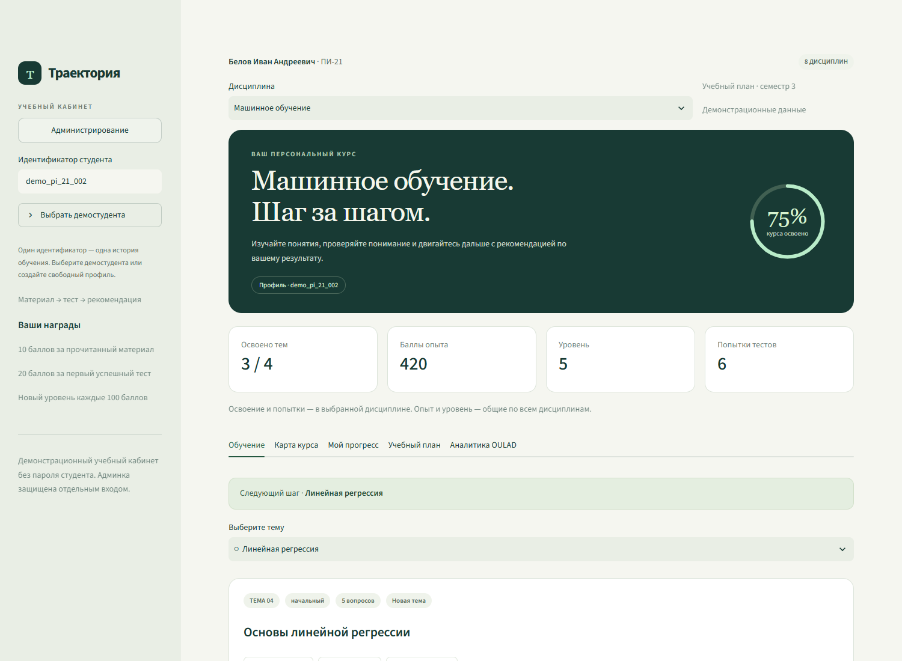
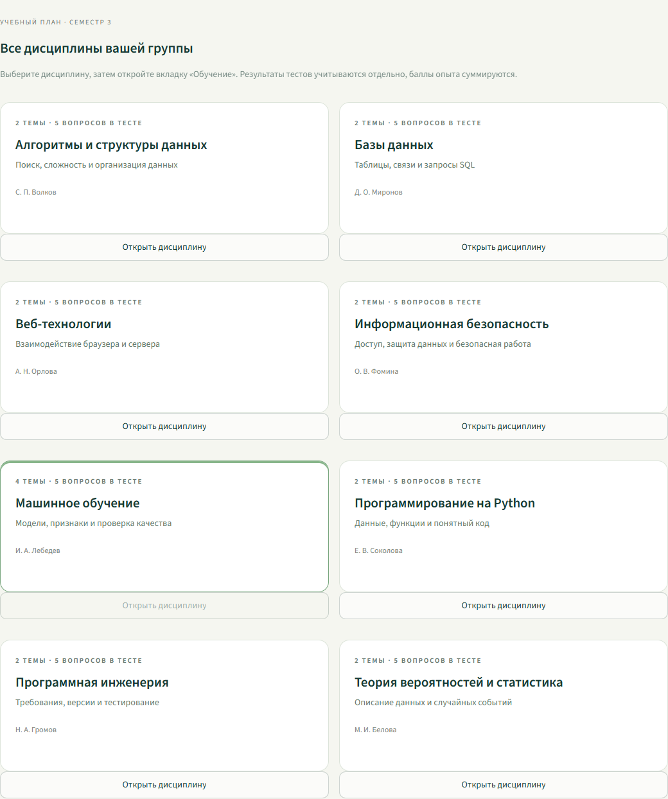
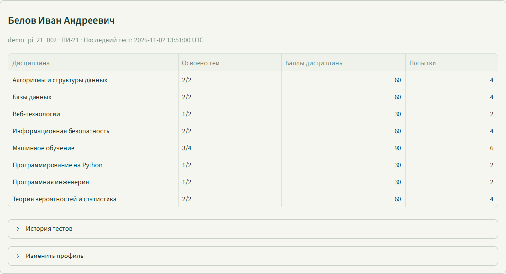

# Проверка групп, дисциплин и администрирования

Откройте `adaptive-learning-project/ЗАПУСТИТЬ.cmd`. Сайт работает по адресу http://localhost:8501. Если он уже запущен, обновите страницу браузера. Рабочая база сохраняется при остановке и повторном запуске.

## Учебный кабинет

1. В боковой панели раскройте «Выбрать демостудента», выберите ПИ-21 или ИВТ-21 и студента, затем нажмите «Открыть профиль».
2. Проверьте имя, группу и восемь дисциплин в выпадающем списке. На вкладке «Учебный план» должны быть восемь карточек.
3. Выберите Python. Появятся две темы и тест из пяти вопросов. Переключитесь на машинное обучение — здесь четыре темы и собственный прогресс.
4. У нового студента без активности прочитайте материал и отметьте его изученным: +10 баллов. Успешный тест от 80 % даёт +20 один раз. Повторное успешное прохождение не увеличивает награду.
5. Смените дисциплину. Счётчики тем, попытки и достижения относятся к ней; опыт и уровень остаются общими. Обновите страницу: профиль и дисциплина восстановятся из адреса.
6. Для проверки пустого профиля подходят `demo_pi_21_005` и `demo_ivt_21_005`. Для истории с повторными попытками — `demo_pi_21_002`. Для примера затруднений — `demo_pi_21_004`. После ваших действий их результаты, конечно, изменятся.





## Администрирование

1. Нажмите «Администрирование» или откройте http://localhost:8501/?view=admin.
2. Логин — `admin`. Пароль автоматически создан в `adaptive-learning-project/.runtime/admin_access.txt`. Откройте этот локальный файл. В архиве программы пароля нет: на другом компьютере создастся свой.
3. До входа видна только форма. Неверный пароль должен показывать сообщение об ошибке. После входа исходный набор содержит 30 студентов, две группы, десять дисциплин.
4. Выберите фильтр ПИ-21: останется 15 студентов. Введите «Белов»: останется одна запись. Фильтр статуса позволяет отобрать студентов, которым нужна практика или поддержка. В исходном наборе статус «Нужна поддержка» имеют 12 студентов.
5. Откройте карточку студента. В ней восемь дисциплин, освоение тем и баллы каждой. Раскройте историю тестов. Выгрузите CSV: он должен соответствовать выбранным фильтрам.
6. На вкладке «Группы и дисциплины» сравните планы: шесть общих дисциплин и по две профильных.
7. На вкладке «Добавить студента» создайте вымышленный профиль, например `student_show_031`, укажите имя и группу. Уникальный идентификатор обязателен. Повторная запись с тем же id отклоняется.
8. Найдите созданного студента, раскройте «Изменить профиль», измените имя или группу. Снимите флажок «Профиль активен» и сохраните: запись останется в админке с пометкой «Архив», а учебный доступ по этому id будет закрыт. Возврат флажка восстанавливает доступ и сохранённую историю.
9. Нажмите «Выйти из админки». Список студентов должен исчезнуть, потребуется повторный вход.




## Как устроены данные

Набор лежит в `adaptive-learning-project/datasets/academy_demo`: students.csv, disciplines.csv, group_disciplines.csv, activities.csv и полный academy.json. Имена и результаты полностью вымышлены. Данные автоматически импортируются один раз, существующая история не удаляется. Новые профили добавляются в SQLite, исходные CSV при этом не переписываются. Актуальный список скачивается из админки.

Статус поддержки вычисляется правилами по последним результатам неосвоенных тем: менее 50 % — поддержка; 50–79 % — практика; при отсутствии попыток — отдельная отметка. Это не прогноз OULAD. Прогноз модели остаётся на самостоятельной вкладке и не использует синтетический набор для обучения.

У студентов пока демонстрационный вход по идентификатору, без личного пароля. Административные запросы требуют серверную сессию, действующую до восьми часов; выход отзывает её. Приложение запускается локально на 127.0.0.1.

## Техническая проверка

Из папки knowledge-project в подготовленном окружении:

```text
python -m unittest test_learning_flow test_portal_exports test_academy -v
python verify_running_demo.py
python verify_academy_ui.py
```

Подтверждены 20 изолированных тестов, 23 проверки основного сценария и 20 проверок академических экранов. Браузером проверены фильтры, выгрузка CSV, сохранение и восстановление имени, выход и экран 390 px без горизонтального переполнения страницы. Дополнительные каталоги Docker, Neo4j и RAG требуют отдельных сервисов и в этот набор проверок не входят.
