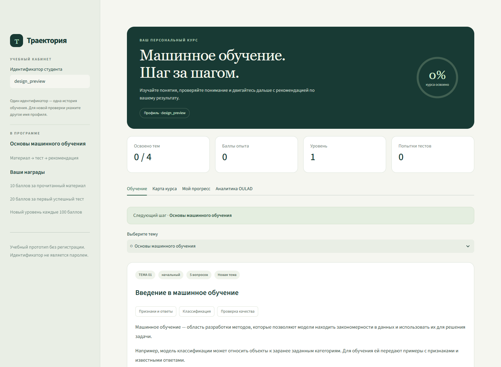
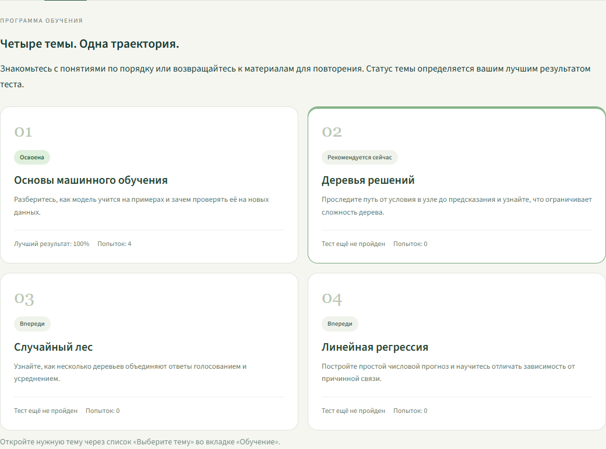
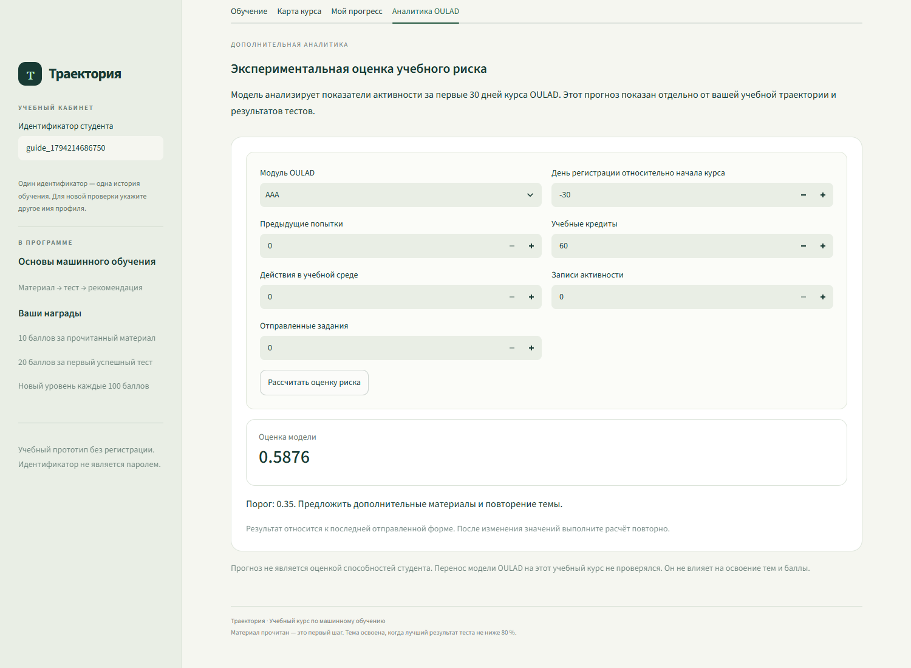

# Полное описание программного комплекса Траектория

Устройство проекта, назначение файлов, алгоритмы, запуск и дальнейшая разработка

Версия интерфейса от 10 ноября 2026 года

## 1 Что представляет собой проект

«Траектория» — локальное веб-приложение с двумя учебными группами, десятью дисциплинами и кабинетом администратора. Демонстрационный план каждой группы содержит восемь дисциплин; всего подготовлены 22 развёрнутые вводные темы и 110 тестовых вопросов. Пользователь читает материал, проходит тест, получает рекомендацию и видит сохранённый прогресс. Баллы, уровни и достижения отражают выполненные учебные действия.

Следующий шаг зависит от ошибок по отдельным понятиям, последних попыток, предпосылок тем и срока повторения. Порог 80 % по-прежнему подтверждает историческое освоение, но персональная рекомендация рассчитывается отдельно. Два одинаковых процента могут вести к разным упражнениям. Причина выбора видна в интерфейсе; самостоятельный выбор материалов сохраняется.

В проекте также есть экспериментальная модель учебного риска OULAD и сохранённые исследовательские модули RAG, ChromaDB и Neo4j. Они решают другие задачи. Прогноз OULAD не оценивает ответы на тесты приложения; RAG не требуется для чтения материалов или начисления баллов.

Это руководство описывает код рабочей папки adaptive-learning-project. Ранние резервные варианты файлов и исходный большой проект в домашнем каталоге Ubuntu не являются текущей точкой запуска.

### 1.1 Что уже реализовано

- Две группы по 15 вымышленных студентов, восемь дисциплин в плане каждой группы.
- Десять дисциплин, 22 материала и 110 вопросов, по пять вопросов на тему.
- Админка с серверным входом, поиском, фильтрами, карточками, добавлением и архивацией студентов.
- Проверка ответов на сервере и разбор ошибок после отправки.
- Диагностика 110 понятий, адресные упражнения и фрагменты конспектов.
- Граф предпосылок, динамика последних попыток и календарь повторения.
- Объяснение индивидуального следующего шага и просмотр диагностики в админке.
- Сохранение чтения, всех допустимых попыток и освоения тем.
- Однократные награды, уровни и четыре достижения.
- Карта курса, история попыток и график изменения результатов.
- Выгрузка истории в CSV и полного прогресса в JSON.
- Сохранение идентификатора профиля в адресе страницы.
- Отдельная форма реального прогноза модели OULAD.
- Запуск трёх локальных процессов одним сценарием Windows.

### 1.2 Что в проект не входит

Личный вход студентов, роль преподавателя, публичное размещение, редактор курсов и автоматическая оценка свободного ответа пока не реализованы. Администратор входит по отдельному паролю, а студенческий кабинет остаётся демонстрационным: идентификатор разделяет записи, но не подтверждает личность. Отметка чтения является самоотчётом пользователя.

Самостоятельная практика показывается текстом и не проверяется автоматически. Её результат подтверждается повторным тестом. Программа не доказывает повышение мотивации или эффективности обучения: проведены технические проверки функций.

## 2 Общая схема работы

```text
Браузер пользователя
        |
Streamlit :8501
student_portal.py -> portal_app.py -> portal_ui.py + academy_portal.py + CSS
        |
FastAPI :8006  unified_api.py
        |
        +-> learning_core.py + academy_core.py -> SQLite learning_progress.db
        |                  -> CSV каталог + JSON тексты и вопросы
        |
        +-> FastAPI :8007 risk_api.py -> day30_logistic.joblib

Дополнительно, при отдельном запуске:
unified_api.py -> каталог :8005 -> ChromaDB + Neo4j
              -> RAG :8003 -> ChromaDB + Qwen на CUDA
```

Браузер получает страницу от Streamlit. Код Streamlit выполняется в Python-процессе и обращается к API через requests. В этой реализации запросы к FastAPI отправляет серверная часть Streamlit, а не отдельное JavaScript-приложение в браузере.

FastAPI предоставляет учебные маршруты и соединяет их с хранилищем. SQLite находится в файле рядом с учебным ядром. Материалы и вопросы читаются из файлов; дополнительная модель риска загружается отдельным сервисом.

### 2.1 Основные адреса

| Адрес | Назначение | Нужен для основного обучения |
| --- | --- | --- |
| http://localhost:8501 | Интерфейс студента | Да |
| http://localhost:8006/docs | Документация общего API | API нужен, страница документации необязательна |
| http://localhost:8006/health | Проверка готовности общего API | Используется менеджером запуска |
| http://localhost:8007/docs | Документация модели риска | Только для аналитики OULAD |
| http://localhost:8005/docs | Расширенный поиск каталога | Нет, отдельный запуск |
| http://localhost:8003/docs | RAG по документам | Нет, отдельный запуск |

Все три процесса основного запуска привязаны к 127.0.0.1. Адрес localhost открывает приложение на этом компьютере и не является публичной ссылкой.

## 3 Как устроены папки

```text
adaptive-learning-project/
  ЗАПУСТИТЬ.cmd                 запуск из Windows
  ОСТАНОВИТЬ.cmd                остановка своих процессов
  start_demo.ps1               перевод пути Windows в путь WSL
  manage_demo.py               управление тремя процессами
  requirements-demo.txt        зависимости основного сценария
  .streamlit/config.toml       общая тема Streamlit
  .runtime/                   журналы, PID и локальные резервные копии
  knowledge-project/          сайт, API, учебные данные, прогресс
    student_portal.py          точка входа интерфейса
    portal_app.py              страницы, формы и запросы к API
    portal_ui.py               оформление компонентов и CSV
    academy_portal.py          учебный план и административные экраны
    academy_core.py            группы, студенты, импорт и вход администратора
    assets/portal.css          стили сайта
    learning_core.py           тестирование, траектория и SQLite
    adaptive_engine.py         диагностика ответов и правила маршрута
    adaptive_ui.py             маршрут, понятия и повторение
    unified_api.py             единый FastAPI
    material_content.json      учебные тексты
    quizzes.json               вопросы, ответы и практика
    learning_progress.db       пользовательские результаты
    project_results/           отчёты проверок и старых экспериментов
  learning-content/            22 Markdown-конспекта и catalog.json
  datasets/build_lessons.py    сборка текстов и практики без изменения ключей
  datasets/academy_demo/       синтетический академический набор CSV/JSON
  datasets/build_academy_demo.py генератор воспроизводимого набора
  coursework-data/oulad/       подготовка данных и модель риска
    models/                    сохранённая модель
    prepared/                  подготовленные CSV в рабочей копии
    results/                   метрики и параметры экспериментов
  graph-db-lab/                каталог тем и работа с графом
  rag-system/                  поиск по документам и генерация ответа
  vector-db-lab/               примеры ChromaDB
  docs/                        копия подробного руководства
```

Директории с именами chroma_db и manual_chroma_db содержат векторные индексы. Они относятся к дополнительным модулям. Файлы с _before_ и расширением .bak — прежние резервные варианты; запускать их вместо текущих модулей не следует.

В комплекте для передачи не требуется сохранять пользовательский learning_progress.db: при первом обращении к прогрессу таблицы создаются автоматически. Крупные исходные CSV OULAD и веса языковой модели также не нужны для основного учебного сценария.

## 4 Интерфейс и дизайн

### 4.1 student_portal.py

Это короткая точка входа для Streamlit. Она импортирует main из portal_app и вызывает её. Команда запуска должна по-прежнему указывать student_portal.py. Основная логика интерфейса вынесена в отдельные файлы, чтобы изменение дизайна не затрагивало серверное ядро.

```python
from portal_app import main

main()
```

### 4.2 portal_app.py

Модуль собирает страницу, получает состояние пользователя и обрабатывает действия. Его основные функции:

| Функция | Что делает |
| --- | --- |
| main | Настраивает страницу, проверяет профиль, получает траекторию, рисует общий блок и вкладки |
| sidebar | Показывает название, поле идентификатора, правила наград и пояснение профиля |
| api | Отправляет HTTP-запрос; при ошибке показывает понятное сообщение |
| study_view | Показывает материал, тест, результат, практику и разбор ответов |
| course_view | Рисует карточки тем выбранной дисциплины со статусами и лучшими результатами |
| progress_view | Показывает достижения, историю, график и кнопки выгрузки |
| analytics_view | Собирает признаки OULAD, запрашивает и сохраняет последний прогноз |
| select_material | Обновляет выбранную тему при переходе к следующей |

main сначала получает идентификатор из боковой панели. Разрешены буквы, цифры, точки, дефисы и подчёркивания. Затем значение записывается в параметр student адреса страницы. Благодаря этому обновление браузера сохраняет выбранный профиль.

При смене профиля очищается временный результат теста и прогноза в сеансе, а выбранная тема определяется заново. Записи других профилей не удаляются. Новое состояние считывается через GET /learning-path/{student_id}.

### 4.3 Пять вкладок учебного кабинета

«Обучение» — основной рабочий экран. Сначала видны рекомендация и выбор темы, затем карточка текста, результат последней отправки и вопросы. Подробная карточка результата находится над вопросами. Краткий итог также показывается под кнопкой отправки, чтобы его было видно сразу после решения длинной формы.

«Карта курса» — обзор содержания. Карточка сообщает тему, краткую цель, лучший процент и число попыток. Текущая рекомендация выделена рамкой и подписью; освоенные темы имеют отдельный статус. Карта не блокирует остальные материалы.

«Мой прогресс» — награды и история. Полученные достижения отличаются от ещё не открытых. При наличии нескольких попыток доступен график результатов в хронологическом порядке. CSV и JSON формируются для текущего профиля и выбранной дисциплины. Баллы total_points и уровень общие по всем дисциплинам; course_points, попытки, освоение и достижения относятся к выбранной дисциплине.

«Учебный план» — восемь дисциплин зарегистрированной группы или десять в свободном демопрофиле. Кнопка карточки меняет выбранную дисциплину. Имя и группа видны над общим блоком, дисциплина сохраняется в параметре discipline адреса.

«Аналитика OULAD» — отдельный экспериментальный прогноз. Результат сохраняется в состоянии сеанса и остаётся видимым при обычных перерисовках страницы. Если поля формы изменены, показанный прогноз всё ещё относится к последней отправленной форме; для нового результата нужно нажать кнопку расчёта.

### 4.4 portal_ui.py

Этот файл содержит компоненты представления. Он не принимает решения об освоении темы и не изменяет базу данных. hero показывает название курса и реальный процент освоения. lesson_meta формирует подписи темы, уровня и статуса. score_panel отображает проверенный сервером результат. course_card и achievement_card рисуют карточки.

Краткие описания и учебные ориентиры поступают из собранной библиотеки; LESSON_INFO остаётся запасным вариантом для старого каталога. Названия исходной дисциплины и её порядок задаются CSV, а редактируемые тексты и метаданные — learning-content. Правильные ответы хранятся в quizzes.json и additional_quizzes.json.

progress_csv создаёт CSV с разделителем «;» и кодировкой UTF-8 с BOM. В выгрузку попадает каждая попытка в хронологическом порядке. Заголовок есть даже у пустой истории. Если тема когда-либо будет удалена из каталога, функция использует её сохранённый идентификатор вместо названия.

### 4.5 assets/portal.css и config.toml

CSS определяет светлый фон, тёмно-зелёный главный блок, карточки, отступы, кнопки, состояния теста и оформление небольшого экрана. В ключевых контейнерах используются имена lesson_reading, quiz_panel, progress_history и risk_panel. Их CSS-классы создаёт Streamlit по параметру key.

config.toml задаёт базовые цвета самой библиотеки: primaryColor, backgroundColor, secondaryBackgroundColor и textColor. Изменение CSS обычно появляется при перерисовке, а изменение конфигурации темы надёжнее проверять после перезапуска Streamlit.

Тексты, которые вставляются в HTML-компоненты, экранируются через html.escape. В частности, введённый идентификатор не должен интерпретироваться как HTML. Нативные формы и кнопки остаются элементами Streamlit.

### 4.6 Параметры окружения

| Параметр | Где читается | Для чего нужен |
| --- | --- | --- |
| LEARNING_API_URL | portal_app.py при импорте | Адрес общего API, по умолчанию http://127.0.0.1:8006 |
| LEARNING_PROGRESS_DB | learning_core.py при импорте | Путь к файлу прогресса вместо стандартного |
| LEARNING_ADMIN_PASSWORD | academy_core.admin_password | Необязательный пароль администратора вместо автоматически созданного локального |
| NEO4J_URI | catalog_api.material_graph | Адрес дополнительной графовой базы |
| NEO4J_PASSWORD | catalog_api.material_graph | Пароль подключения, требуется только для графовых запросов |

Адреса RAG и каталога в unified_api заданы в константах и строках вызовов. Это не переменные окружения. При переносе дополнительных сервисов их нужно согласованно изменить в коде. Модель риска и её файл порога ищутся относительно risk_api.py.





## 5 Учебные тексты и вопросы

### 5.1 learning_materials.csv

Файл находится в graph-db-lab и служит каталогом. Его поля: id, title, topic, level. Порядок строк определяет порядок поиска следующей темы. Идентификатор связывает каталог с текстом, вопросами и сохранёнными попытками.

Текущие темы: mat_01 — основы машинного обучения, mat_02 — деревья решений, mat_03 — случайный лес, mat_04 — линейная регрессия. Уровень материала берётся из каталога. Это характеристика материала, а не игровой уровень студента.

### 5.2 material_content.json

Ключ верхнего уровня — идентификатор материала. Значение содержит title, topic и content. Для текущего сайта каталог предоставляет название и метаданные, а JSON — content. Желательно сохранять названия согласованными в обоих файлах, чтобы старый метод /material-content тоже выдавал одинаковую информацию.

Поле content содержит Markdown с заголовками, списками и блоками кода. Страница отображает его через st.markdown. Редактируемый первоисточник — learning-content/{id}.md; после изменения выполните python datasets/build_lessons.py. Непосредственная правка собранного JSON будет заменена при следующей сборке.

### 5.3 quizzes.json

У каждой темы есть practice и questions. practice — текст самостоятельного задания для среднего результата. questions — список вопросов со следующими полями:

| Поле | Смысл |
| --- | --- |
| id | Устойчивый идентификатор вопроса, используется также в ключе виджета |
| text | Формулировка вопроса |
| options | Список вариантов ответа |
| correct | Индекс правильного варианта, начиная с нуля |
| explanation | Объяснение правильного ответа |

Пример одного вопроса:

```json
{
  "id": "example_1",
  "text": "Что предсказывает классификация?",
  "options": ["Категорию", "Только дробное число", "Адрес сервера"],
  "correct": 0,
  "explanation": "Классификация относит объект к классу."
}
```

Индекс correct равен 0 для первого варианта, 1 для второго и 2 для третьего. В ручной инструкции номера вариантов даны начиная с единицы. Смешение этих двух способов нумерации — частая причина неправильного результата при тестировании API.

В текущем курсе ровно пять вопросов на тему. Сервер вычисляет процент по фактической длине списка, но текст подсказки и проверочный сценарий интерфейса рассчитаны на пять. При изменении числа вопросов необходимо обновить связанные подписи и проверки.

### 5.4 Редактируемая библиотека learning-content

Библиотека включает 22 вводных занятия по десяти дисциплинам. Для каждого id есть Markdown-файл с шестью смысловыми разделами: понятия, объяснение метода, разобранный пример, дополнительные условия применения, ошибки и основные выводы. В сумме основные тексты содержат 8628 слов; задания, ориентиры и источники добавлены отдельно. Это число описывает объём, а не полноту семестровой программы.

catalog.json связывает id с discipline_id, summary, outcomes, assignment, self_check и sources. Исходники написаны для проекта, примеры используют вымышленные данные. Дополнительное чтение ведёт на 26 страниц документации и учебных ресурсов: Python, SQLite, MDN, scikit-learn, MIT, Brown University, NIST, OWASP, IETF, IANA и Linux man-pages.

datasets/build_lessons.py проверяет совпадение id с каталогами, читает Markdown, рассчитывает ориентировочное время чтения и записывает дополнительные поля в material_content.json и additional_materials.json. В обоих банках вопросов обновляется только текст самостоятельной практики. Идентификаторы вопросов, варианты, правильные индексы и объяснения не меняются. Сборка не открывает SQLite и не сбрасывает прогресс.

После генерации академического набора build_academy_demo автоматически повторно вызывает сборку занятий, чтобы учебные тексты не заменялись короткими заготовками. Результат можно проверить командой python knowledge-project/verify_lesson_content.py из корня. Общий редактируемый сборник создаётся в docs/Учебные_материалы.md.

В study_view под заголовком видны учебные ориентиры и примерное время чтения. Затем отображается полный текст с кодом. Ниже находятся раскрываемые блоки задания, ориентира и источников. lesson_markdown собирает скачиваемый конспект текущей темы. Автоматическая проверка самостоятельной работы не реализована; её не следует путать с последующим тестом из пяти вопросов.

verify_lesson_content.py содержит 63 проверки: совпадение опубликованного текста с исходником, состав скачиваемых заметок, выполнение 11 Python-примеров с ожидаемым выводом, схемы и запросы SQL в памяти, ограничение внешнего ключа и сохранность всех ключей тестов. Дополнительно браузером проверены раскрытие блоков, действительная загрузка Markdown и мобильный вид. Прежние 20 изолированных тестов и 43 проверки интерфейса после расширения также пройдены.


## 6 Серверное учебное ядро learning_core.py

Этот модуль является источником правил адаптации, освоения и наград. Изменение цвета карточки не меняет правило, а изменение правила в этом файле должно сопровождаться проверками API и синхронизацией интерфейсных подсказок.

### 6.1 Загрузка содержания

materials(discipline_id) читает исходные CSV/JSON и additional_materials.json, связывает по id и возвращает выбранную дисциплину. Значение по умолчанию machine_learning сохраняет исходный сценарий из четырёх тем. all_materials возвращает 22 темы. find_material ищет среди всех материалов и возвращает 404 для неизвестного id. quizzes объединяет исходные вопросы и additional_quizzes.json.

Файлы читаются при обращениях к функциям. Для 22 демонстрационных тем это небольшая нагрузка. При существенном росте каталога следует пересмотреть повторные чтения и добавить проверку согласованности данных перед запуском.

### 6.2 Хранение и получение прогресса

init_progress_db создаёт таблицы и индекс, если они отсутствуют. complete_item разрешает отметить только известный материал. Попытку вручную отметить task этот маршрут отклоняет: задание засчитывается исключительно при серверной проверке теста.

attempt_rows возвращает краткую историю попыток конкретного профиля. get_progress проверяет учебный доступ через academy_core.check_access, затем вызывает progress_for. Эта внутренняя функция читает завершения, вычисляет общий опыт и уровень, а также достижения и число освоенных тем выбранной дисциплины. Клиент не передаёт готовую сумму опыта и не может задать её этим API.

valid_student обрезает пробелы и проверяет длину и допустимые символы идентификатора. Эта проверка служит валидацией входных данных, а не авторизацией.

### 6.3 Проверка теста

get_quiz возвращает только id, text и options. Ключ correct и объяснение не отправляются при обычном получении вопросов. После решения разбор становится доступным в ответе проверки, поскольку это режим учебного самоконтроля.

QuizSubmission описывает идентификатор и список строгих целых чисел. Строки вида "1" и значения true/false не принимаются вместо числовых индексов. submit_quiz проверяет существование темы, число ответов и допустимость каждого варианта.

Затем сравниваются ответы и правильные индексы. Процент вычисляется на сервере, попытка сохраняется в SQLite. При результате от 80 % в той же транзакции создаётся уникальное завершение задания. Возвращаются процент, число верных ответов, рекомендация, разбор, награда и актуальный прогресс.

### 6.4 Общая траектория

learning_path проверяет учебный доступ и передаёт данные в assemble_path. Эта функция получает статусы каталога, подробные ответы и вызывает adaptive_engine.build_adaptive_state. Для каждой темы определяются последний процент, лучший процент, число попыток, отметка чтения и освоение. Освоение означает наличие хотя бы одной попытки не ниже 80 %.

recommended_material_id определяется адаптивным движком: сначала актуальное затруднение и его необходимые основы, затем доступная новая тема, затем наступившее плановое повторение. Если всё освоено и повторение не требуется, значение null. Историческое освоение сохраняется при неудачном повторе; рекомендация при этом может вернуть уже освоенную тему. Полный результат находится в adaptive, профиль отдельной темы — в diagnostics.

## 7 Адаптация и геймификация по шагам

### 7.1 Начальная реакция на процент

| Процент S | action в ответе | Что видит пользователь |
| --- | --- | --- |
| S < 50 | repeat | Предложение повторить материал и разобрать ошибки |
| 50 ≤ S < 80 | practice | Дополнительное задание и повторный тест |
| S ≥ 80 | advance | Подтверждение освоения и следующая тема |

В пяти вопросах возможны 0, 20, 40, 60, 80 и 100 %. Эти пороги являются проектными правилами. Они не подбирались по результатам педагогического эксперимента.

### 7.2 Откуда берутся баллы

Формула: баллы = 10 × число прочитанных материалов + 20 × число впервые успешно пройденных тестов. Формула уровня: floor(баллы / 100) + 1.

При первом чтении темы сохраняется завершение material с её id. При первом успешном тесте сохраняется завершение task с id вида quiz_mat_01. Ограничение UNIQUE не позволяет создать такое завершение повторно для того же пользователя.

За неуспешный тест баллы не начисляются. Повторный успешный тест записывается в историю, но также не даёт повторной награды. Поэтому многократная отправка формы не позволяет накапливать опыт за одно и то же задание.

Чтение всех материалов даёт 40 баллов, успешное прохождение всех тестов — 80. В сумме дисциплина «Машинное обучение» даёт 120 баллов и второй уровень на новом профиле. Полный план зарегистрированной группы из 18 тем даёт 540 баллов. Опыт и уровень суммируются по всем дисциплинам. Игровой уровень не является уровнем сложности материала и не определяет освоение темы.

### 7.3 Достижения

| Название | Условие открытия |
| --- | --- |
| Первый изученный материал | Есть хотя бы одно завершение чтения |
| Первый пройденный тест | Есть хотя бы одна тема с результатом от 80 % |
| Без ошибок | Есть хотя бы одна попытка 100 % |
| Все темы освоены | Успешные попытки покрывают все id каталога |

Интерфейс показывает как полученные, так и ещё не открытые достижения. Сервер определяет фактический список наград; оформление карточки только отображает это решение.

### 7.4 Профиль понятий и адресная коррекция

В learning-content/adaptive_catalog.json каждому из 110 существующих вопросов соответствует понятие, номер раздела и отдельное упражнение. Сами вопросы и ключи не меняются. Раздел извлекается из текущего Markdown-конспекта, поэтому студент видит нужное объяснение рядом с конкретным пробелом.

Для каждой темы анализируются до трёх последних допустимых попыток. У двух попыток веса 1 и 2, у трёх — 1, 2 и 3. Взвешенная точность понятия равна 100 × сумме весов верных ответов / сумме весов всех учтённых ответов. Например, верный ответ, затем неверный дают 33,3 %. Это описательная характеристика ответов на вопрос, не вероятность знания всего понятия.

Ошибки последней попытки формируют список повторения. Ошибка в двух последних ответах получает приоритет; далее учитывается взвешенная точность. На экране показаны три приоритетных понятия, полный список находится в профиле знаний. Отдельные задания проверяются самостоятельно; повторный тест обновляет наблюдения.

### 7.5 История попыток и граф предпосылок

Динамика сравнивает два последних результата: от +20 процентных пунктов — рост, от −20 — снижение. Две последние попытки ниже 80 % включают режим разбора примера. Если после успешного освоения результат снизился, включается восстановление понимания без отмены старой награды.

Граф задаёт предпосылки внутри дисциплины. Для машинного обучения цепочка основы → деревья → лес, а линейная регрессия опирается на основы. Для девяти других дисциплин вторая тема опирается на первую. При затруднении движок проверяет предпосылки транзитивно и возвращает к самой ранней незакреплённой основе. После её успешного прохождения маршрут возвращается к ожидающему затруднению, а не обязательно к следующей строке каталога.

Рекомендация содержит material_id, исходную target_material_id, режим kind, текст reason, понятия focus_concepts и три шага steps. Каждый шаг указывает чтение, практику или проверку. Историческое освоение и текущая готовность к следующему шагу намеренно различаются.

### 7.6 Календарь и приоритеты

После одного успешного теста повторение назначается через три дня, после двух последовательных успехов — через семь, после трёх и более — через четырнадцать. Дата вычисляется от последней успешной попытки и выводится в UTC. Неудачный повтор требует актуального восстановления; он не даёт награду и не стирает успех.

| Приоритет | Следующий шаг |
| --- | --- |
| Есть текущие затруднения | Последняя проблемная тема или её недостающая предпосылка |
| Нет текущих затруднений, есть новые темы | Первая доступная неосвоенная тема с готовыми предпосылками |
| Всё освоено, есть наступившее повторение | Самая ранняя дата из календаря |
| Всё освоено, срок не наступил | Обязательный следующий шаг отсутствует |

Пока есть новые темы, наступившие даты остаются в отдельном календаре. Система не блокирует свободный выбор материала. Интервалы и пороги являются настройками проекта, а не результатом педагогического эксперимента.

### 7.7 Новые модули и проверка

adaptive_engine.py получает материалы, вопросы и сохранённые ответы; не записывает новую оценку знания в базу и не обучает модель. Профиль восстанавливается из quiz_attempts. Записи с недопустимым массивом ответов не считаются доказательством правильности или ошибки. Область вычисления ограничена выбранным студентом и дисциплиной.

adaptive_ui.py показывает маршрут, причины, фрагменты, задания, таблицу понятий и календарь. В админке защищённая карточка содержит «Пробелы и индивидуальные рекомендации». Модель OULAD по-прежнему является отдельным прогнозом; не используется как неподтверждённая вероятность знания студента.

test_adaptive_engine содержит 13 проверок: одинаковые оценки с разными ошибками, одинаковый последний процент с разной историей, окно и веса, возврат к нужной ветви и транзитивным основам, приоритет повторных ошибок, сохранение наград, сроки, отсутствие немедленного цикла после свежего успеха, разделение профилей/дисциплин и недопустимая история. Общий набор изолированных тестов — 33 из 33. verify_adaptive_ui добавляет 17 живых проверок к прежним 43; всего 60 проверок интерфейса и интеграции.

### 7.8 Как показать работу на защите

После запуска выполните python prepare_adaptive_demo.py из knowledge-project. Свободные вымышленные профили создаются один раз без изменения 30 зарегистрированных студентов. При повторном запуске существующая история не сбрасывается.

adaptive_demo_a получает 60 % с ошибками в обучении с учителем и классификации. adaptive_demo_b получает те же 60 % с ошибками в признаках и переобучении. У них разные упражнения и разделы повторения. adaptive_demo_prerequisite показывает ошибку в лесе и переход к недостающей основе. Если пройти её, рекомендация продолжит цепочку подготовки.

Эта демонстрация подтверждает изменение учебного маршрута по наблюдениям. Она не доказывает улучшение успеваемости, точную оценку скрытого знания или автоматическую проверку открытого ответа. Подбор новых вопросов по сложности пока не реализован.


## 8 База данных

Основной файл — knowledge-project/learning_progress.db. Если переменная окружения LEARNING_PROGRESS_DB задана до запуска API, вместо него используется указанный путь. Это удобно для отдельного окружения или проверки, но требует перезапуска процесса после изменения переменной.

### 8.1 Таблица completions

| Поле | Назначение |
| --- | --- |
| id | Порядковый целочисленный ключ |
| student_id | Идентификатор профиля |
| item_type | material или task |
| item_id | id материала либо quiz_ + id материала |
| completed_at | Время создания в UTC |

Уникальная комбинация student_id, item_type, item_id защищает награду от дублирования. Запись выполняется через INSERT ... ON CONFLICT DO NOTHING. Параметры SQL передаются отдельно от текста запроса.

### 8.2 Таблица quiz_attempts

| Поле | Назначение |
| --- | --- |
| id | Порядок попыток |
| student_id | Профиль владельца попытки |
| material_id | Тема теста |
| answers | JSON-массив выбранных индексов |
| correct_count | Число верных ответов |
| question_count | Число вопросов в данной попытке |
| score | Результат в процентах |
| created_at | Время записи в UTC |

Индекс quiz_student ускоряет выборку попыток по профилю и теме. GET /progress выдаёт краткие сведения о попытках; выбранные ответы сохраняются в базе, но не включаются в этот краткий ответ.

### 8.3 Что сохраняется после обновления страницы

В SQLite сохраняются отметки чтения, попытки и завершения тестов. Из них восстанавливаются освоение, баллы и достижения. В адресе страницы сохраняются идентификатор профиля и выбранная дисциплина.

Текущий открытый блок разбора и последний прогноз OULAD хранятся в session_state Streamlit. Они переживают перерисовки в рамках сеанса, но не являются долговременными записями в базе. После полного обновления браузера последний прогноз нужно рассчитать заново.

Для резервной копии работающей базы предпочтителен SQLite backup API, а не простое копирование в момент записи. Тесты ядра используют отдельную временную базу и не очищают рабочую историю.

## 9 Основные методы API

Все учебные адреса ниже относятся к порту 8006. Схемы запросов можно открыть в /docs. Методы без обязательного тела запроса вызываются GET; операции записи используют POST и PUT.

| Метод и путь | Функция | Назначение |
| --- | --- | --- |
| GET /health | unified_api.health | Готовность основного сервиса и число материалов |
| GET /learning-path/{student_id} | learning_core.learning_path | Полная траектория и текущий прогресс |
| GET /progress/{student_id} | learning_core.get_progress | Действия, попытки, опыт, уровень и награды |
| POST /progress/complete | learning_core.complete_item | Отметка чтения известного материала |
| GET /quiz/{material_id} | learning_core.get_quiz | Вопросы и варианты без ключа |
| POST /quiz/{material_id}/submit | learning_core.submit_quiz | Проверка ответов и сохранение результата |
| POST /student-dashboard | unified_api.student_dashboard | Запрос модели риска и сведения по теме |
| POST /topic-materials | unified_api.topic_materials | Точное совпадение темы среди ещё не освоенных материалов |
| GET /material-content/{material_id} | unified_api.material_content | Текст по id, используется также прежним интерфейсом |

### 9.1 Отметить чтение

```json
{
  "student_id": "api_demo",
  "item_type": "material",
  "item_id": "mat_01"
}
```

Тело отправляется на POST /progress/complete. При первой записи created равно true. При повторе created равно false; баллы сохраняются без удвоения. Неизвестный материал даёт 404, попытка указать item_type task — 422.

### 9.2 Пройти тест через API

```json
{
  "student_id": "api_demo",
  "answers": [1, 0, 2, 0, 1]
}
```

Для POST /quiz/mat_01/submit этот набор соответствует пяти правильным ответам текущего теста. Индексы начинаются с нуля. Процент нельзя передать вместо массива answers: его вычисляет сервер.

Результат содержит score, correct_count, question_count, passed, action, message, points_awarded, feedback и progress. Поле attempt_id идентифицирует сохранённую попытку. При среднем результате practice содержит дополнительное задание, в других случаях — null.

### 9.3 Ошибки

404 означает, что указанный материал не найден. 422 означает некорректные данные: недопустимый идентификатор, неправильное число ответов, индекс за границей вариантов или попытку ручного зачёта task. Недоступность дополнительного сервиса в объединённом API может возвращаться как 503.

Сейчас post_json в unified_api оборачивает ошибки внешних сервисов в 503, в том числе часть их собственных ошибок запроса. Непосредственный risk_api при неизвестном коде модуля возвращает 422. Эти два способа вызова нельзя считать полностью одинаковыми по кодам ошибок.

### 9.4 Остальные сохранённые маршруты

POST /ask объединяет векторный каталог и RAG, по флагу добавляя факты графа. POST /ask-manual обращается к RAG по методичке. POST /adaptive-recommendation использует прежнюю схему: риск и семантический подбор начального материала. Эти маршруты требуют отдельно запущенных сервисов и не являются механизмом тестовой адаптации текущего курса.

POST /gamification-preview рассчитывает демонстрационные баллы из переданных количеств и не сохраняет результат. В текущем интерфейсе он не используется. Для фактического прогресса следует обращаться к учебным маршрутам, работающим с базой.

## 10 Модель учебного риска OULAD

### 10.1 risk_api.py

Сервис в coursework-data/oulad загружает models/day30_logistic.joblib и results/day30_logistic_test.json. При старте проверяются существование файлов, допустимость порога, список признаков и наличие класса риска 1. Модель загружается через joblib один раз на жизненный цикл процесса.

GET /health сообщает готовность и порог. POST /predict-risk принимает семь признаков. Код модуля приводится к верхнему регистру и проверяется по категориям обученной модели.

| Признак | Смысл |
| --- | --- |
| code_module | Код учебного модуля OULAD |
| date_registration | День регистрации относительно начала курса |
| num_of_prev_attempts | Число предыдущих попыток |
| studied_credits | Учебные кредиты |
| vle_clicks | Сумма действий с 0-го по 30-й день |
| vle_records | Количество записей активности за этот период |
| submitted_count | Число отправленных работ за этот период |

Предсказание получается через predict_proba для класса 1. Оценка сравнивается с порогом 0,35. Для стандартного примера AAA, -30, 0, 60, 0, 0, 0 в текущем окружении получено 0,5876. Изменение признаков требует повторного расчёта.

### 10.2 Как подготовлены данные

prepare_day30.py читает исходные CSV, соединяет сведения о студентах и регистрации и оставляет тех, кто зарегистрирован и ещё учится на 30-й день. Для Withdrawn с неизвестной датой прекращения обучения запись исключается.

Активность и отправки агрегируются только за дни 0–30 включительно. Сами итоговые исходы не используются как входные признаки. Fail и Withdrawn образуют класс риска 1, Pass и Distinction — класс 0.

split_day30.py разделяет данные с группировкой по id_student. Это исключает одновременное присутствие одного человека в обучающей и тестовой частях. Внутри обучения также выделяется групповая валидация.

### 10.3 Назначение скриптов OULAD

| Файл | Что делает |
| --- | --- |
| prepare_day30.py | Строит признаки и целевую переменную на 30-й день |
| split_day30.py | Создаёт обучающую и тестовую части по группам студентов |
| train_baseline_day30.py | Сравнивает базовый классификатор и логистическую регрессию |
| compare_day30_models.py | Сравнивает модели на валидации |
| evaluate_thresholds.py | Сравнивает пороги решения на валидации |
| evaluate_day30_test.py | Обучает итоговый конвейер, сохраняет модель и тестовые метрики |
| evaluate_temporal_day30.py | Проверяет перенос между запусками 2013 и 2014 годов |
| risk_api.py | Загружает сохранённую модель и обслуживает запрос прогноза |

Перед повторным обучением необходимо вернуть исходные файлы в coursework-data/oulad/raw. Крупные CSV находятся в исходном проекте Ubuntu; компактный архив для запуска их не содержит.

### 10.4 Как понимать результаты

В сохранённой групповой тестовой оценке 5493 записи. ROC AUC составляет 0,7228, F1 класса риска — 0,6541, precision — 0,5403, recall — 0,8286. При пороге 0,35 модель выдаёт много ложных предупреждений: в матрице есть 1715 ложноположительных результатов.

Временная оценка содержит отдельные результаты для новых студентов 2014 года; общий ROC AUC — 0,6928. Порог ранее выбирался по смешанной по годам валидации, что указано в файле результатов. Эти сохранённые эксперименты не повторялись при изменении дизайна.

Нельзя считать полученную оценку прогнозом знания тем текущего курса. Связь между OULAD и этим курсом не исследовалась. Поэтому аналитика не меняет результат теста, баллы или освоение материала.



## 11 Дополнительные модули поиска и генерации

### 11.1 Каталог ChromaDB

build_catalog.py читает learning_materials.csv, формирует описания и вычисляет эмбеддинги моделью paraphrase-multilingual-MiniLM-L12-v2. Затем данные записываются в коллекцию learning_catalog локальной ChromaDB.

search_catalog.py демонстрирует поиск. catalog_api.py предоставляет /search, /search-with-graph и получение связей материала /materials/{material_id}/graph. Для работы требуются индекс, модель эмбеддингов и, для графовых сведений, Neo4j.

В текущем учебном ядре точная тема выбирается прямо из локального CSV. Чтение четырёх материалов не вызывает эмбеддинги и не запускает ChromaDB.

### 11.2 Граф Neo4j

graph-db-lab содержит проверку подключения, анализ графа и импорт/экспорт. learning_materials.csv — основной каталог тем; graph_nodes_export.csv и graph_relationships_export.csv — сохранённые выгрузки узлов и связей.

Связи предварительных тем использовались в дополнительных экспериментах: например, деревья решений предшествуют случайному лесу. Текущая рекомендация курса использует порядок каталога и лучший тестовый результат, а не полный обход графа.

### 11.3 RAG

rag-system/rag_api.py соединяет поиск фрагментов и формирование ответа. Тексты кодируются той же мультиязычной моделью эмбеддингов, а ответ формирует Qwen2.5-1.5B-Instruct. В этой версии код явно требует доступную CUDA для загрузки генеративной модели.

Маршрут /ask работает с коллекцией учебных фрагментов, /ask-with-graph принимает дополнительные факты графа, /ask-manual использует индекс PDF-методички. Формирование ответов синхронизируется через generation_lock.

index_lab_manual.py готовит индекс методички. search_lab_manual.py и evaluate_manual_search.py относятся к поиску по ней. Файлы compare_*, evaluate_* и answer_* содержат отдельные эксперименты с генерацией, поиском и метриками. Их результаты сохранены в JSON рядом со скриптами.

### 11.4 Где описан прежний запуск

knowledge-project/README_START.md содержит старый порядок запуска Neo4j, каталога и RAG. Он относится к расширенному исследовательскому окружению. Текущий запуск из ЗАПУСТИТЬ.cmd не выполняет эти команды и не пытается поднять Docker.

Расширенные модули сохранены в исходниках, но не входят в текущие 23 проверки интерфейса. Для них нужны отдельные индексы, сервисы и подходящее окружение. В архиве для передачи векторные индексы могут отсутствовать.

## 12 Запуск и остановка

### 12.1 На текущем компьютере

Открой ЗАПУСТИТЬ.cmd. Он вызывает start_demo.ps1 с временным параметром ExecutionPolicy Bypass для этого запуска сценария; постоянные настройки политики не меняются. PowerShell получает текущую папку, переводит путь через wslpath и обращается к установленной Ubuntu.

Используется существующий интерпретатор /home/hxrdbvss/miniconda3/envs/mlops-lab/bin/python. manage_demo.py запускает три процесса, ждёт их готовности и сохраняет журналы в .runtime. Затем открывается браузер.

Штатный менеджер считает сборку готовой только после успешной проверки всех трёх процессов. Если нужен курс без аналитики модели, основной API и Streamlit можно запустить вручную отдельно. Для запуска через готовый сценарий файл модели должен присутствовать.

Для остановки открой ОСТАНОВИТЬ.cmd. Менеджер проверяет командную строку записанного PID и останавливает только процессы данной папки. Файл прогресса при этом не удаляется.

### 12.2 Команды из Ubuntu

Выполнять из корня текущей копии проекта:

```bash
/home/hxrdbvss/miniconda3/envs/mlops-lab/bin/python manage_demo.py start
/home/hxrdbvss/miniconda3/envs/mlops-lab/bin/python manage_demo.py status
/home/hxrdbvss/miniconda3/envs/mlops-lab/bin/python manage_demo.py stop
```

### 12.3 В другом окружении

requirements-demo.txt содержит версии библиотек, на которых проверена программа. Сначала подготовь Python-окружение и установи зависимости:

```bash
python -m pip install -r requirements-demo.txt
```

На Linux можно использовать python manage_demo.py start. Менеджер ориентирован на Linux/WSL, поскольку проверяет /proc. Для Windows без WSL три сервиса следует запускать вручную в отдельных терминалах:

```text
python -m uvicorn unified_api:app --app-dir knowledge-project --host 127.0.0.1 --port 8006
python -m uvicorn risk_api:app --app-dir coursework-data/oulad --host 127.0.0.1 --port 8007
python -m streamlit run knowledge-project/student_portal.py --server.address 127.0.0.1 --server.port 8501
```

Эти команды выполняются из корня проекта. Запуск в совершенно чистом окружении отдельно не подтверждён. Сохранённый файл scikit-learn-модели следует загружать совместимыми версиями библиотек, указанными в requirements-demo.txt.

## 13 Проверки и их результаты

### 13.1 Тесты ядра, академической части и адаптации

Из папки knowledge-project:

```bash
python -m unittest test_learning_flow test_portal_exports test_academy test_adaptive_engine -v
```

test_learning_flow.py содержит десять тестов: ветви адаптации, переход темы, повторные награды, неудачный повтор после освоения, отдельный учёт чтения, неверные запросы, скрытие ключа, отдельные профили, параллельные запросы и полный курс.

test_portal_exports.py содержит три проверки CSV: сохранение кириллицы и всех процентов, корректный заголовок пустой истории и выгрузка старой попытки при отсутствии темы в каталоге. test_academy.py добавляет семь тестов импорта, воспроизводимости результатов, учебных планов, раздельного прогресса, входа и выхода администратора, добавления и архивации. В test_adaptive_engine добавлены ещё 13 проверок индивидуальной диагностики, истории, предпосылок и повторения. Подтверждён общий результат 33 из 33.

### 13.2 Проверка запущенного интерфейса

После запуска сервисов:

```bash
python verify_running_demo.py
```

Сценарий использует Streamlit AppTest с отдельным случайным профилем и обращается к реальным API. Подтверждены 23 проверки: основные учебные действия, сохранение идентификатора в URL, наличие карты курса, три ветви, повторный тест без повторной награды, переход темы и сохранение последнего прогноза в сеансе.

Отчёты: project_results/current_unit_tests.txt и project_results/current_demo_validation.json. Исторические JSON экспериментов в той же папке не являются результатом последнего запуска интерфейса.

### 13.3 Проверка браузером

Новый дизайн проверяется на обычном экране и узком экране телефона. Проверяются отображение карточек, чтение вопросов, отсутствие горизонтального переполнения страницы, загрузка CSV и доступность пяти учебных разделов и административных экранов. Браузерная выгрузка истории содержит заголовок и все четыре попытки проверочного профиля.


## 14 Что и где менять при дальнейшей разработке

### 14.1 Поменять цвета и отступы

Редактируй knowledge-project/assets/portal.css. Общие переменные --ink, --muted, --paper, --line и --mint находятся в начале файла. Базовые цвета нативных элементов также заданы в .streamlit/config.toml. После изменения конфигурации перезапусти сайт и проверь основной и мобильный экраны.

### 14.2 Изменить текст страницы

Название курса и главный блок находятся в portal_ui.hero. Боковая панель — в portal_app.sidebar. Формулировки разделов — в study_view, course_view, progress_view и analytics_view. Описания учебных ориентиров — в LESSON_INFO.

Не заменяй серверные условия освоения только текстом интерфейса. Если подпись обещает новый порог или награду, соответствующее правило должно быть изменено в learning_core и проверено тестами.

### 14.3 Добавить тему

1. Выбери новый устойчивый id, например mat_05.
2. Добавь строку в graph-db-lab/learning_materials.csv в нужное место траектории.
3. Добавь исходник learning-content/{id}.md и метаданные в learning-content/catalog.json, а также запись каталога material_content.json для новой исходной темы.
4. Добавь practice и пять вопросов в quizzes.json.
5. Заполни summary, outcomes, assignment, self_check и sources в метаданных, затем запусти datasets/build_lessons.py.
6. Для исходной дисциплины обнови тест полного курса, ожидающий 120 баллов.
7. Проверь новую тему, её освоение и достижение всех тем на отдельном профиле.

Число тем в интерфейсе теперь определяется каталогом. Дополнительные дисциплины и их темы задаются datasets/build_academy_demo.py и файлами datasets/academy_demo. При изменении набора нужны согласованные вопросы и материалы, учебный план и стратегия миграции: маркер academy-demo-v1 защищает уже загруженную базу от повторного импорта.

### 14.4 Изменить вопрос

Для исходной дисциплины редактируй questions нужной темы в quizzes.json; для дополнительных дисциплин меняй описание вопроса в datasets/build_academy_demo.py и пересобирай каталог. Сборщик материалов меняет только practice и сохраняет вопросы, варианты и ключи. Проверь, что correct находится в допустимом диапазоне и explanation соответствует варианту. Если меняется смысл уже существующего задания, старые попытки останутся оценёнными по прежней версии.

Версии вопросов пока не сохраняются. Для серьёзного изменения курса нужно добавить версионирование либо проверять новую редакцию на новых идентификаторах. Не следует пересчитывать старый score по обновлённому ключу без явного решения о миграции.

### 14.5 Изменить порог освоения

Сейчас 80 % используется в adaptation, submit_quiz, progress_for, assemble_path, adaptive_engine.build_adaptive_state, academy_core.ensure_academy и roster. Также порог упоминается в интерфейсных подписях, достижениях и тестах. Перед изменением найди все эти места. При дальнейшем развитии стоит вынести значение в одну общую константу.

Порог модели OULAD 0,35 — другая величина. Он находится в результатах модели и не должен подменять порог учебного теста.

### 14.6 Изменить награды

Баллы 10 и 20 рассчитываются в progress_for и roster, а награда за успешную попытку возвращается submit_quiz. Подсказки находятся в sidebar и карточке чтения. Уровень сейчас вычисляется каждые 100 баллов. Согласованно обнови сервер, подписи, выгрузки и тест полного курса.

### 14.7 Добавить личную авторизацию студентов

Административный вход уже реализован в academy_core. Для личного входа студентов одного поля идентификатора недостаточно. Потребуются пользователи, безопасное хранение паролей или внешний вход, сессии и проверка владельца каждого запроса. После этого student_id должен определяться сервером из подтверждённой сессии, а не приниматься на доверии из формы.

Текущая база позволяет начать проектирование такой связи, но автоматического безопасного перехода к многопользовательскому публичному сервису в ней нет. Это отдельная функциональная доработка.

### 14.8 Добавить проверяемую практику

Нужно определить формат ответа и критерий проверки, добавить схему запроса, хранение попыток практики и отдельный серверный метод. Награду следует выдавать после успешной проверки. Простая кнопка «Практика выполнена» не подтверждает результат и не заменяет проверку.

## 15 Если что-то не работает

| Симптом | Где смотреть | Что проверить |
| --- | --- | --- |
| localhost:8501 не открывается | .runtime/portal.log | Запущен ли Streamlit и свободен ли порт |
| Страница есть, но материал не загружается | .runtime/api.log | Готовность /health на порту 8006 |
| Аналитика не отвечает | .runtime/risk.log | Модель, файл порога и версии scikit-learn |
| Указан занятый порт | manage_demo.py status | Не остался ли частичный запуск; чужие процессы не завершаются автоматически |
| Не появилась новая тема | CSV, оба JSON, LESSON_INFO | Совпадают ли id и корректен ли JSON |
| Баллы не выросли после успешного повтора | completions | Награда за тот же тест уже учтена; это ожидаемо |
| После обновления исчез разбор | session_state | История в базе сохраняется; открытый разбор относится к сеансу |
| Прогноз остался прежним после ввода чисел | analytics_view | Нажата ли кнопка повторного расчёта |
| RAG требует CUDA или индекс | rag_api.py | Запущен дополнительный модуль, не обязательный для курса |

При частично запущенном собственном приложении используй stop, затем start. Не удаляй learning_progress.db ради перезапуска. Для пустого учебного профиля достаточно другого идентификатора.

## 16 Как объяснить проект на защите

Короткое объяснение: «Я разработал прототип системы дистанционного обучения, в котором рекомендация следующего действия зависит от результата теста. Сервер проверяет ответы, сохраняет попытки и начисляет награду за успешное завершение только один раз. Интерфейс показывает карту курса, историю и достижения».

Если спросят про адаптивность, сравни adaptive_demo_a и adaptive_demo_b: одинаковые 60 %, но разные понятия и упражнения. Затем покажи возврат к предпосылке и профиль знаний. Три результата 40, 60 и 100 % иллюстрируют только исходную пороговую реакцию. Если спросят про геймификацию, покажи 10 баллов за материал и 20 за первое успешное прохождение, затем повтори тест без увеличения награды. Если спросят про хранение — объясни таблицы попыток и завершений, отдельные таблицы групп и студентов и уникальное завершение. Покажи поиск в админке и учебный план из восьми дисциплин.

Модель машинного обучения используется в отдельной аналитике OULAD. Диагностика понятий, зависимости, динамика и календарь реализованы отдельным объяснимым движком правил. Генеративная модель находится в дополнительном RAG-модуле, который запускается отдельно. Такая формулировка соответствует фактической реализации.

Нельзя утверждать, что уже реализованы защищённая регистрация, полноценная LMS, автоматическая проверка свободного ответа или подтверждённое повышение успеваемости. В текущей версии технически проверен ограниченный учебный сценарий.

### 16.1 Короткий словарь проекта

| Термин | Простое объяснение |
| --- | --- |
| Frontend | Часть приложения, с которой взаимодействует пользователь; здесь это страницы Streamlit |
| Backend | Серверная логика проверки, прогресса и интеграции модели |
| API | Набор правил и адресов, через которые одна часть программы обращается к другой |
| Маршрут или endpoint | Конкретный адрес операции, например /quiz/mat_01/submit |
| JSON | Текстовый формат структурированных данных; здесь вопросы, настройки и HTTP-ответы |
| SQLite | База данных в одном локальном файле |
| Транзакция | Несколько записей, которые должны завершиться согласованно; здесь попытка и награда |
| session_state | Временные значения текущего сеанса Streamlit, которые не равны записям в SQLite |
| Inference | Получение прогноза уже обученной моделью без повторного обучения |
| Эмбеддинг | Числовое представление текста для сравнения и поиска похожих фрагментов |
| RAG | Сначала поиск фрагментов, затем генерация ответа с использованием найденного контекста |
| Групповое разделение | Способ разнести данные так, чтобы один студент не оказался в обеих выборках |
| Precision | Доля действительно неблагоприятных исходов среди выданных предупреждений модели |
| Recall | Доля найденных неблагоприятных исходов среди всех таких исходов |

Награды приложения и метрики модели относятся к разным данным. Например, 80 % в тесте — четыре правильных ответа из пяти, а recall 0,8286 — показатель сохранённого эксперимента OULAD, а не процент правильных ответов пользователя.

### 16.2 Группы, датасет и администрирование

Синтетический набор academy-demo-v1 находится в datasets/academy_demo. Его создаёт datasets/build_academy_demo.py с фиксированным зерном 20261109. Две группы ПИ-21 и ИВТ-21 содержат по 15 студентов. Шесть дисциплин общие, две профильные у каждой группы; таким образом, в группе восемь дисциплин, а в общем каталоге десять. На группу приходится 18 тем, всего в приложении 22 разных темы и 110 вопросов.

Имена, преподаватели, планы и история вымышлены. Это набор для наполнения и технической проверки программы. Он не является источником модели OULAD и не подтверждает педагогическую эффективность. Все 22 темы содержат развёрнутую теорию, примеры, типичные ошибки и самостоятельную работу. Это вводные занятия, которые не заменяют полную семестровую программу дисциплин.

| Файл набора | Назначение |
| --- | --- |
| academy.json | Полный импорт групп, дисциплин, студентов и попыток с ответами |
| students.csv | Студенты, принадлежность группе, активность и заданный сценарий |
| disciplines.csv | Дисциплины, описания, преподаватели и семестр |
| group_disciplines.csv | 16 связей учебной группы с дисциплиной |
| activities.csv | Результаты и даты попыток, удобно просматривать в Excel |
| additional_materials.json | 18 новых материалов; исходные четыре сохранены отдельно |
| additional_quizzes.json | 90 новых вопросов с ключами и объяснениями |

CSV имеют разделитель «;» и UTF-8 с BOM. Время UTC. Генератор задаёт пять сценариев: уверенное освоение, постепенное прохождение с повторами, практика, затруднения и отсутствие активности. Значение scenario служит только для генерации. Админка заново вычисляет статусы по фактической истории.

### 16.3 academy_core.py и таблицы академической части

ensure_academy создаёт дополнительные таблицы без удаления прежних. Импорт выполняется в транзакции BEGIN IMMEDIATE с повторной проверкой маркера версии. Данные студентов вставляются только при отсутствии их идентификатора. Для каждого нового студента попытки загружаются с вычислением score по ответам, чтение и успешные тесты создают уникальные завершения. Повторный запуск не дублирует историю и не сбрасывает правки администратора.

| Таблица | Поля и назначение |
| --- | --- |
| academic_groups | id, name, program — учебные группы |
| disciplines | id, name, description, teacher, semester — каталог дисциплин |
| group_disciplines | group_id, discipline_id — учебный план; составной первичный ключ |
| students | id, full_name, group_id, active, source, created_at — зарегистрированные профили |
| academy_meta | key, value — маркер однократного импорта |
| admin_sessions | token_hash, expires_at — хеш токена и срок административной сессии |

check_access проверяет существование дисциплины и, для зарегистрированного студента, активность и наличие дисциплины в плане его группы. Существующие свободные профили поддерживаются как демонстрационный режим. Архивированный зарегистрированный профиль не получает учебный доступ. Администратор может просмотреть его историю отдельным защищённым маршрутом.

roster пакетно читает студентов, попытки и завершения. Процент прогресса считается по темам текущего учебного плана; опыт сохраняет все заработанные баллы, в том числе после перевода в другую группу. Нет попыток — отдельный статус. Последний результат неосвоенной темы ниже 50 % означает «Нужна поддержка», от 50 до 79 % — «Нужна практика»; при наличии обеих ситуаций приоритет у поддержки. Уже подтверждённое освоение сохраняется при неудачной пересдаче.

### 16.4 Вход и функции администратора

Адрес: http://localhost:8501/?view=admin. Логин admin. Пароль берётся из LEARNING_ADMIN_PASSWORD, если переменная задана. Иначе он генерируется secrets.token_urlsafe и записывается в .runtime/admin_access.txt. Этот файл исключён из архива. На новом компьютере будет собственный пароль; публиковать его вместе с исходниками не требуется.

После успешного входа сервер выдаёт случайный токен на восемь часов. В SQLite хранится его SHA-256-хеш. Все административные данные и операции требуют заголовок Authorization: Bearer; одного переключения страницы недостаточно. Выход удаляет сессию. Предусмотрен предел десяти неудачных входов за минуту в одном процессе. Приложение работает локально; отдельные аккаунты и роли нескольких администраторов пока не предусмотрены.

academy_portal.administration рисует форму входа, показатели и три вкладки. «Все студенты» содержит поиск по имени или id, фильтр группы и статуса, архивные профили, CSV и карточку студента с восемью дисциплинами и историей. «Группы и дисциплины» сравнивает планы. «Добавить студента» создаёт профиль с уникальным id. В карточке доступны имя, перевод в другую группу и флаг активности. Архивация не удаляет историю.

| Метод API | Назначение |
| --- | --- |
| GET /academy/catalog | Планы, дисциплины и выбор только синтетических демостудентов |
| GET /academy/profile/{student_id} | Доступные дисциплины выбранного демопрофиля |
| POST /admin/login | Проверка логина и пароля, выпуск сессии |
| POST /admin/logout | Отзыв текущей сессии |
| GET /admin/overview | Защищённая сводка всех зарегистрированных студентов |
| GET /admin/students/{student_id} | Защищённая карточка с результатами по дисциплинам |
| POST /admin/students | Добавление студента; повторный id возвращает 409 |
| PUT /admin/students/{student_id} | Изменение имени, группы и активности; id неизменяем |

GET /learning-path и GET /progress принимают discipline_id, по умолчанию machine_learning. Функция progress_for используется внутренне и не открывает обход проверки доступа через HTTP-параметры. course_points, действия, попытки, освоение и достижения ограничены выбранной дисциплиной; total_points, level и остаток до уровня общие. POST проверки теста определяет дисциплину по материалу и также проверяет учебный доступ.

### 16.5 Проверки расширения и иллюстрации

test_academy содержит семь изолированных проверок: состав и связи набора, однократный импорт с сохранением истории и правок, воспроизводимость процентов, ограничения учебного плана, разделение прогресса и общего опыта, защита маршрутов с отзывом сессии и создание/изменение/архивация студента. Вместе с прежними проверками — 20 из 20.

verify_academy_ui.py выполняет 20 проверок работающего интерфейса: восемь дисциплин, смена курса и профиля, учебный план, вход с неверным и верным паролем, поиск, фильтр группы, карточка, пустой результат и выход. Результат — project_results/current_academy_validation.json. Прежний verify_running_demo.py по-прежнему проходит 23 проверки. Отдельно браузером подтверждены сохранение и обратное восстановление имени, CSV выбранной строки, защищённая форма входа и мобильная ширина 390 px без горизонтального переполнения страницы.


## 17 Навигация по исходникам

Следующий раздел формируется автоматически по текущим файлам. Он содержит имена функций, их строки и список файлов без временных журналов, резервных вариантов, пользовательской базы и внутренних файлов векторных индексов. Номера строк соответствуют версии руководства и могут измениться после правок.

<!-- AUTOGENERATED INVENTORY -->
### 17.1 Функции основных модулей

### coursework-data/oulad/risk_api.py

| Функция | Строка | Назначение |
| --- | --- | --- |
| lifespan | 62 | Загрузка и проверка сохранённой модели при старте. |
| health | 111 | Проверка состояния сервиса. |
| predict_risk | 121 | Валидация кода модуля и получение вероятности риска. |

Модели данных: StudentFeatures (строка 27).


### datasets/build_academy_demo.py

| Функция | Строка | Назначение |
| --- | --- | --- |
| build | 146 | Вспомогательная функция модуля. |

### datasets/build_adaptive_catalog.py

| Функция | Строка | Назначение |
| --- | --- | --- |
| build | 143 | Вспомогательная функция модуля. |

### datasets/build_lessons.py

| Функция | Строка | Назначение |
| --- | --- | --- |
| read_json | 10 | Чтение исходного JSON учебной библиотеки. |
| write_json | 14 | Запись скомпилированного каталога в UTF-8. |
| build | 18 | Вспомогательная функция модуля. |

### knowledge-project/academy_core.py

| Функция | Строка | Назначение |
| --- | --- | --- |
| dataset | 24 | Чтение полного синтетического набора. |
| connect | 28 | Соединение с текущей SQLite. |
| ensure_academy | 34 | Однократный транзакционный импорт групп, студентов и попыток. |
| check_access | 82 | Проверка активности профиля и учебного плана. |
| catalog | 96 | Каталог групп, дисциплин и вымышленных профилей. |
| profile | 115 | Доступные дисциплины текущего демопрофиля. |
| admin_password | 130 | Пароль из окружения или локального файла. |
| login | 152 | Проверка входа и выпуск административной сессии. |
| authorized | 169 | Проверка Bearer-сессии и срока. |
| logout | 181 | Отзыв текущей административной сессии. |
| roster | 187 | Пакетная сводка всех зарегистрированных студентов. |
| overview | 212 | Защищённая сводка админки. |
| student_detail | 221 | Защищённая карточка с результатами дисциплин. |
| save_student | 251 | Валидация и запись профиля без удаления истории. |
| create_student | 271 | Добавление уникального профиля. |
| edit_student | 276 | Изменение имени, группы и активности. |

Модели данных: Login (строка 146), StudentWrite (строка 237).


### knowledge-project/academy_portal.py

| Функция | Строка | Назначение |
| --- | --- | --- |
| choose_profile | 11 | Открытие выбранного демостудента. |
| choose_course | 15 | Выбор дисциплины из карточки учебного плана. |
| curriculum | 20 | Карточки дисциплин группы. |
| export_roster | 32 | CSV отфильтрованного списка студентов. |
| administration | 41 | Форма входа и административные экраны. |

### knowledge-project/adaptive_engine.py

| Функция | Строка | Назначение |
| --- | --- | --- |
| policy_catalog | 14 | Чтение понятий, упражнений и графа предпосылок. |
| section_excerpt | 18 | Нужный раздел конспекта для конкретного пробела. |
| parse_time | 23 | Разбор даты сохранённой попытки в UTC. |
| build_adaptive_state | 31 | Профиль ответов, динамика, предпосылки и объяснимый маршрут повторения. |

### knowledge-project/adaptive_ui.py

| Функция | Строка | Назначение |
| --- | --- | --- |
| route_overview | 13 | Персональный шаг с объяснением и планом действий. |
| topic_diagnostics | 34 | Приоритетные ошибки, упражнения и фрагменты конспекта. |
| knowledge_profile | 55 | Таблица понятий и календарь повторения. |

### knowledge-project/learning_core.py

| Функция | Строка | Назначение |
| --- | --- | --- |
| materials | 16 | Соединение каталога и учебных текстов. |
| all_materials | 25 | Все 22 материала десяти дисциплин. |
| quizzes | 30 | Чтение банка вопросов. |
| find_material | 35 | Поиск id с ошибкой 404 для неизвестного. |
| init_progress_db | 42 | Создание таблиц и индекса без удаления истории. |
| valid_student | 67 | Валидация идентификатора. |
| complete_item | 88 | Уникальная отметка чтения. |
| attempt_rows | 105 | Краткая история попыток профиля. |
| get_progress | 118 | Расчёт прогресса и наград из базы. |
| progress_for | 124 | Прогресс дисциплины и общий опыт из базы; внутренний вызов. |
| adaptation | 156 | Выбор repeat, practice или advance. |
| learning_path | 165 | Статусы тем и первая неосвоенная рекомендация. |
| assemble_path | 171 | Статусы тем с адаптивной диагностикой; внутренний вызов. |
| get_quiz | 199 | Вопросы без правильных индексов. |
| submit_quiz | 218 | Проверка ответов и транзакционная запись результата. |

Модели данных: CompleteRequest (строка 74), QuizSubmission (строка 205).


### knowledge-project/portal_app.py

| Функция | Строка | Назначение |
| --- | --- | --- |
| api | 17 | HTTP-запрос к общему API и сообщение об ошибке. |
| select_material | 39 | Смена выбранной темы. |
| sidebar | 43 | Идентификатор и боковая панель. |
| study_view | 76 | Материал, тест, практика и разбор. |
| course_view | 154 | Карта курса. |
| progress_view | 166 | Награды, история, график и выгрузки. |
| analytics_view | 201 | Форма и сохранение последнего прогноза OULAD. |
| main | 234 | Главная функция запуска или сборки страницы модуля. |

### knowledge-project/portal_ui.py

| Функция | Строка | Назначение |
| --- | --- | --- |
| html | 18 | Вывод подготовленного HTML-компонента. |
| apply_style | 22 | Чтение CSS из assets. |
| hero | 26 | Название курса и процент освоения. |
| lesson_meta | 40 | Подписи уровня, номера и статуса. |
| score_panel | 47 | Карточка проверенного результата теста. |
| course_card | 56 | Карточка темы на карте курса. |
| achievement_card | 66 | Полученное или ещё не открытое достижение. |
| progress_csv | 71 | CSV истории с BOM и разделителем ;. |
| lesson_markdown | 82 | Конспект темы с самостоятельным заданием, ориентиром и источниками для скачивания. |

### knowledge-project/student_portal.py

| Функция | Строка | Назначение |
| --- | --- | --- |
| Точка входа | 1 | Импорт main из portal_app и вызов. |

### knowledge-project/unified_api.py

| Функция | Строка | Назначение |
| --- | --- | --- |
| health | 22 | Проверка состояния сервиса. |
| post_json | 44 | Обращение к дополнительному сервису. |
| ask | 63 | Поиск и RAG-ответ с опциональными фактами графа. |
| ask_manual | 105 | Ответ по PDF-методичке. |
| adaptive_recommendation | 145 | Прежняя схема риска и семантического поиска. |
| gamification_preview | 195 | Расчёт наград без сохранения. |
| student_dashboard | 246 | Прогноз OULAD и информация по теме. |
| topic_materials | 306 | Точный отбор неосвоенных тем. |
| material_content | 335 | Получение текста по id. |

Модели данных: AskRequest (строка 29), AdaptiveRequest (строка 120), GamificationRequest (строка 181), StudentDashboardRequest (строка 229), TopicMaterialsRequest (строка 292).


### manage_demo.py

| Функция | Строка | Назначение |
| --- | --- | --- |
| ready | 22 | HTTP-проверка готовности процесса. |
| occupied | 30 | Проверка занятости порта. |
| own_process | 35 | Проверка принадлежности PID текущей папке. |
| stop | 42 | Остановка подтверждённых процессов проекта. |
| main | 48 | Главная функция запуска или сборки страницы модуля. |

### 17.2 Указатель файлов

В указателе 159 файлов текущих модулей и сохранённых результатов. Временные данные и внутренние файлы индексов исключены.

| Файл относительно корня проекта | Назначение |
| --- | --- |
| .streamlit/config.toml | Базовая тема Streamlit. |
| coursework-data/oulad/compare_day30_models.py | Подготовка или оценка OULAD; назначение группы описано в разделе 10. |
| coursework-data/oulad/evaluate_day30_test.py | Подготовка или оценка OULAD; назначение группы описано в разделе 10. |
| coursework-data/oulad/evaluate_temporal_day30.py | Подготовка или оценка OULAD; назначение группы описано в разделе 10. |
| coursework-data/oulad/evaluate_thresholds.py | Подготовка или оценка OULAD; назначение группы описано в разделе 10. |
| coursework-data/oulad/models/day30_logistic.joblib | Сохранённый конвейер модели риска. |
| coursework-data/oulad/prepare_day30.py | Подготовка или оценка OULAD; назначение группы описано в разделе 10. |
| coursework-data/oulad/results/baseline_day30_validation.json | Сохранённые параметры и метрики эксперимента OULAD. |
| coursework-data/oulad/results/day30_logistic_test.json | Сохранённые параметры и метрики эксперимента OULAD. |
| coursework-data/oulad/results/day30_model_comparison_validation.json | Сохранённые параметры и метрики эксперимента OULAD. |
| coursework-data/oulad/results/day30_temporal_evaluation.json | Сохранённые параметры и метрики эксперимента OULAD. |
| coursework-data/oulad/results/day30_thresholds_validation.json | Сохранённые параметры и метрики эксперимента OULAD. |
| coursework-data/oulad/risk_api.py | Основной модуль; функции описаны выше. |
| coursework-data/oulad/split_day30.py | Подготовка или оценка OULAD; назначение группы описано в разделе 10. |
| coursework-data/oulad/train_baseline_day30.py | Подготовка или оценка OULAD; назначение группы описано в разделе 10. |
| datasets/academy_demo/academy.json | Синтетический академический набор: состав, поля и загрузка описаны в разделе 16.2. |
| datasets/academy_demo/activities.csv | Синтетический академический набор: состав, поля и загрузка описаны в разделе 16.2. |
| datasets/academy_demo/additional_materials.json | Синтетический академический набор: состав, поля и загрузка описаны в разделе 16.2. |
| datasets/academy_demo/additional_quizzes.json | Синтетический академический набор: состав, поля и загрузка описаны в разделе 16.2. |
| datasets/academy_demo/disciplines.csv | Синтетический академический набор: состав, поля и загрузка описаны в разделе 16.2. |
| datasets/academy_demo/group_disciplines.csv | Синтетический академический набор: состав, поля и загрузка описаны в разделе 16.2. |
| datasets/academy_demo/README.md | Синтетический академический набор: состав, поля и загрузка описаны в разделе 16.2. |
| datasets/academy_demo/students.csv | Синтетический академический набор: состав, поля и загрузка описаны в разделе 16.2. |
| datasets/build_academy_demo.py | Основной модуль; функции описаны выше. |
| datasets/build_adaptive_catalog.py | Основной модуль; функции описаны выше. |
| datasets/build_lessons.py | Основной модуль; функции описаны выше. |
| graph-db-lab/graph_analysis.py | Работа с Neo4j либо экспорт узлов и связей. |
| graph-db-lab/graph_import_export.py | Работа с Neo4j либо экспорт узлов и связей. |
| graph-db-lab/graph_nodes_export.csv | Работа с Neo4j либо экспорт узлов и связей. |
| graph-db-lab/graph_relationships_export.csv | Работа с Neo4j либо экспорт узлов и связей. |
| graph-db-lab/learning_materials.csv | Каталог и порядок тем. |
| graph-db-lab/neo4j_check.py | Работа с Neo4j либо экспорт узлов и связей. |
| knowledge-project/.dockerignore | Настройки дополнительного контейнерного каталога. |
| knowledge-project/academy_core.py | Основной модуль; функции описаны выше. |
| knowledge-project/academy_portal.py | Основной модуль; функции описаны выше. |
| knowledge-project/adaptive_engine.py | Основной модуль; функции описаны выше. |
| knowledge-project/adaptive_ui.py | Основной модуль; функции описаны выше. |
| knowledge-project/assets/portal.css | Дизайн и адаптация интерфейса к ширине экрана. |
| knowledge-project/build_catalog.py | Вспомогательный файл учебного или исследовательского модуля. |
| knowledge-project/catalog_api.py | Вспомогательный файл учебного или исследовательского модуля. |
| knowledge-project/Dockerfile | Настройки дополнительного контейнерного каталога. |
| knowledge-project/final_scenario_result.json | Сохранённый результат отдельного эксперимента; имя файла определяет вариант. |
| knowledge-project/graph_context_comparison.json | Сохранённый результат отдельного эксперимента; имя файла определяет вариант. |
| knowledge-project/learning_core.py | Основной модуль; функции описаны выше. |
| knowledge-project/manual_api_test_results.json | Сохранённый результат отдельного эксперимента; имя файла определяет вариант. |
| knowledge-project/material_content.json | Тексты четырёх учебных материалов. |
| knowledge-project/portal_app.py | Основной модуль; функции описаны выше. |
| knowledge-project/portal_ui.py | Основной модуль; функции описаны выше. |
| knowledge-project/prepare_adaptive_demo.py | Создание трёх свободных демонстрационных профилей без сброса истории. |
| knowledge-project/project_results/academy_browser_validation.json | 13 браузерных проверок групп, админки, CSV и мобильного экрана. |
| knowledge-project/project_results/adaptive_browser_validation.json | Браузерная проверка разных пробелов, предпосылок, календаря и мобильного вида. |
| knowledge-project/project_results/adaptive_demo_profiles.json | Адреса трёх свободных демонстрационных профилей и исходные рекомендации. |
| knowledge-project/project_results/current_academy_validation.json | Отчёт 20 проверок академического интерфейса. |
| knowledge-project/project_results/current_adaptive_validation.json | 17 проверок адаптивных сценариев в работающем интерфейсе. |
| knowledge-project/project_results/current_demo_validation.json | Последний отчёт 23 проверок интерфейса и API. |
| knowledge-project/project_results/current_unit_tests.txt | Отчёт изолированных тестов ядра, академической части и выгрузки. |
| knowledge-project/project_results/final_scenario_result.json | Сохранённый результат отдельного эксперимента; имя файла определяет вариант. |
| knowledge-project/project_results/graph_context_comparison.json | Сохранённый результат отдельного эксперимента; имя файла определяет вариант. |
| knowledge-project/project_results/lesson_browser_validation.json | Сохранённый результат отдельного эксперимента; имя файла определяет вариант. |
| knowledge-project/project_results/lesson_content_validation.json | 63 проверки содержания всех 22 тем и учебных примеров. |
| knowledge-project/project_results/manual_answer_comparison.json | Сохранённый результат отдельного эксперимента; имя файла определяет вариант. |
| knowledge-project/project_results/manual_api_test_results.json | Сохранённый результат отдельного эксперимента; имя файла определяет вариант. |
| knowledge-project/project_results/manual_retrieval_evaluation.json | Сохранённый результат отдельного эксперимента; имя файла определяет вариант. |
| knowledge-project/project_results/portal_design_browser.json | Браузерная проверка дизайна, мобильной ширины, CSV/JSON и восстановления профиля. |
| knowledge-project/project_results/retrieval_evaluation.json | Сохранённый результат отдельного эксперимента; имя файла определяет вариант. |
| knowledge-project/quizzes.json | Вопросы, правильные индексы, объяснения и практика. |
| knowledge-project/README_START.md | Прежняя инструкция расширенного запуска Docker и RAG. |
| knowledge-project/requirements-docker.txt | Настройки дополнительного контейнерного каталога. |
| knowledge-project/search_catalog.py | Вспомогательный файл учебного или исследовательского модуля. |
| knowledge-project/student_app.py | Предыдущий интерфейс; текущая точка входа другая. |
| knowledge-project/student_portal.py | Основной модуль; функции описаны выше. |
| knowledge-project/test_academy.py | 7 изолированных проверок импорта, учебных планов, прогресса и административного доступа. |
| knowledge-project/test_adaptive_engine.py | 13 проверок индивидуальной диагностики, зависимостей, динамики и повторения. |
| knowledge-project/test_catalog_api.py | Проверочный сценарий соответствующего дополнительного сервиса. |
| knowledge-project/test_docker_catalog.py | Проверочный сценарий соответствующего дополнительного сервиса. |
| knowledge-project/test_learning_flow.py | 10 тестов правил, транзакций, истории и наград. |
| knowledge-project/test_portal_exports.py | 3 проверки CSV-выгрузки. |
| knowledge-project/test_unified_api.py | Проверочный сценарий соответствующего дополнительного сервиса. |
| knowledge-project/unified_api.py | Основной модуль; функции описаны выше. |
| knowledge-project/unified_demo.py | Вспомогательный файл учебного или исследовательского модуля. |
| knowledge-project/unified_demo_neural_network.json | Сохранённый результат отдельного эксперимента; имя файла определяет вариант. |
| knowledge-project/unified_demo_result.json | Сохранённый результат отдельного эксперимента; имя файла определяет вариант. |
| knowledge-project/verify_academy_ui.py | 20 проверок учебных планов, профилей и админки через AppTest. |
| knowledge-project/verify_adaptive_ui.py | 17 проверок адаптивных сценариев в работающем интерфейсе. |
| knowledge-project/verify_lesson_content.py | Выполнение примеров Python и SQL, проверка выгрузок и совместимости ключей вопросов. |
| knowledge-project/verify_running_demo.py | 23 проверки интерфейса и живой модели. |
| learning-content/adaptive_catalog.json | Редактируемый конспект или метаданные библиотеки 22 вводных занятий; раздел 5.4. |
| learning-content/algorithms_01.md | Редактируемый конспект или метаданные библиотеки 22 вводных занятий; раздел 5.4. |
| learning-content/algorithms_02.md | Редактируемый конспект или метаданные библиотеки 22 вводных занятий; раздел 5.4. |
| learning-content/catalog.json | Редактируемый конспект или метаданные библиотеки 22 вводных занятий; раздел 5.4. |
| learning-content/databases_01.md | Редактируемый конспект или метаданные библиотеки 22 вводных занятий; раздел 5.4. |
| learning-content/databases_02.md | Редактируемый конспект или метаданные библиотеки 22 вводных занятий; раздел 5.4. |
| learning-content/mat_01.md | Редактируемый конспект или метаданные библиотеки 22 вводных занятий; раздел 5.4. |
| learning-content/mat_02.md | Редактируемый конспект или метаданные библиотеки 22 вводных занятий; раздел 5.4. |
| learning-content/mat_03.md | Редактируемый конспект или метаданные библиотеки 22 вводных занятий; раздел 5.4. |
| learning-content/mat_04.md | Редактируемый конспект или метаданные библиотеки 22 вводных занятий; раздел 5.4. |
| learning-content/networks_01.md | Редактируемый конспект или метаданные библиотеки 22 вводных занятий; раздел 5.4. |
| learning-content/networks_02.md | Редактируемый конспект или метаданные библиотеки 22 вводных занятий; раздел 5.4. |
| learning-content/os_01.md | Редактируемый конспект или метаданные библиотеки 22 вводных занятий; раздел 5.4. |
| learning-content/os_02.md | Редактируемый конспект или метаданные библиотеки 22 вводных занятий; раздел 5.4. |
| learning-content/python_01.md | Редактируемый конспект или метаданные библиотеки 22 вводных занятий; раздел 5.4. |
| learning-content/python_02.md | Редактируемый конспект или метаданные библиотеки 22 вводных занятий; раздел 5.4. |
| learning-content/quiz_fingerprints.json | Редактируемый конспект или метаданные библиотеки 22 вводных занятий; раздел 5.4. |
| learning-content/README.md | Редактируемый конспект или метаданные библиотеки 22 вводных занятий; раздел 5.4. |
| learning-content/security_01.md | Редактируемый конспект или метаданные библиотеки 22 вводных занятий; раздел 5.4. |
| learning-content/security_02.md | Редактируемый конспект или метаданные библиотеки 22 вводных занятий; раздел 5.4. |
| learning-content/software_01.md | Редактируемый конспект или метаданные библиотеки 22 вводных занятий; раздел 5.4. |
| learning-content/software_02.md | Редактируемый конспект или метаданные библиотеки 22 вводных занятий; раздел 5.4. |
| learning-content/statistics_01.md | Редактируемый конспект или метаданные библиотеки 22 вводных занятий; раздел 5.4. |
| learning-content/statistics_02.md | Редактируемый конспект или метаданные библиотеки 22 вводных занятий; раздел 5.4. |
| learning-content/web_01.md | Редактируемый конспект или метаданные библиотеки 22 вводных занятий; раздел 5.4. |
| learning-content/web_02.md | Редактируемый конспект или метаданные библиотеки 22 вводных занятий; раздел 5.4. |
| manage_demo.py | Основной модуль; функции описаны выше. |
| rag-system/answer_evaluation.json | Сохранённый результат отдельного эксперимента; имя файла определяет вариант. |
| rag-system/answer_rouge.json | Сохранённый результат отдельного эксперимента; имя файла определяет вариант. |
| rag-system/answer_rouge.py | Дополнительный поиск, генерация ответа или оценка RAG. |
| rag-system/answer_similarity.json | Сохранённый результат отдельного эксперимента; имя файла определяет вариант. |
| rag-system/answer_similarity.py | Дополнительный поиск, генерация ответа или оценка RAG. |
| rag-system/collect_rag_results.py | Дополнительный поиск, генерация ответа или оценка RAG. |
| rag-system/compare_extraction_prompts.py | Дополнительный поиск, генерация ответа или оценка RAG. |
| rag-system/compare_generators.py | Дополнительный поиск, генерация ответа или оценка RAG. |
| rag-system/compare_manual_answers.py | Дополнительный поиск, генерация ответа или оценка RAG. |
| rag-system/compare_prompts.py | Дополнительный поиск, генерация ответа или оценка RAG. |
| rag-system/documents/lab_manual.pdf | Документ для дополнительного RAG по методичке. |
| rag-system/evaluate_answers.py | Дополнительный поиск, генерация ответа или оценка RAG. |
| rag-system/evaluate_manual_search.py | Дополнительный поиск, генерация ответа или оценка RAG. |
| rag-system/evaluate_new_questions.py | Дополнительный поиск, генерация ответа или оценка RAG. |
| rag-system/evaluate_paraphrases.py | Дополнительный поиск, генерация ответа или оценка RAG. |
| rag-system/evaluate_retrieval.py | Дополнительный поиск, генерация ответа или оценка RAG. |
| rag-system/extraction_prompt_comparison.json | Сохранённый результат отдельного эксперимента; имя файла определяет вариант. |
| rag-system/generator_comparison.json | Сохранённый результат отдельного эксперимента; имя файла определяет вариант. |
| rag-system/index_lab_manual.py | Дополнительный поиск, генерация ответа или оценка RAG. |
| rag-system/manual_answer_comparison.json | Сохранённый результат отдельного эксперимента; имя файла определяет вариант. |
| rag-system/manual_answer_test.json | Сохранённый результат отдельного эксперимента; имя файла определяет вариант. |
| rag-system/manual_retrieval_evaluation.json | Сохранённый результат отдельного эксперимента; имя файла определяет вариант. |
| rag-system/new_questions_evaluation.json | Сохранённый результат отдельного эксперимента; имя файла определяет вариант. |
| rag-system/paraphrase_evaluation.json | Сохранённый результат отдельного эксперимента; имя файла определяет вариант. |
| rag-system/prompt_comparison.json | Сохранённый результат отдельного эксперимента; имя файла определяет вариант. |
| rag-system/prompt_manual_assessment.json | Сохранённый результат отдельного эксперимента; имя файла определяет вариант. |
| rag-system/rag_api.py | Дополнительный поиск, генерация ответа или оценка RAG. |
| rag-system/rag_demo.py | Дополнительный поиск, генерация ответа или оценка RAG. |
| rag-system/rag_experiments_collected.json | Сохранённый результат отдельного эксперимента; имя файла определяет вариант. |
| rag-system/rag_interactive.py | Дополнительный поиск, генерация ответа или оценка RAG. |
| rag-system/retrieval_evaluation.json | Сохранённый результат отдельного эксперимента; имя файла определяет вариант. |
| rag-system/retrieval_metrics.json | Сохранённый результат отдельного эксперимента; имя файла определяет вариант. |
| rag-system/retrieval_metrics.py | Дополнительный поиск, генерация ответа или оценка RAG. |
| rag-system/retriever_demo.py | Дополнительный поиск, генерация ответа или оценка RAG. |
| rag-system/search_lab_manual.py | Дополнительный поиск, генерация ответа или оценка RAG. |
| rag-system/test_manual_answer.py | Проверочный сценарий соответствующего дополнительного сервиса. |
| rag-system/test_rag_api.py | Проверочный сценарий соответствующего дополнительного сервиса. |
| README.md | Краткий запуск и состав проекта. |
| requirements-demo.txt | Проверенные зависимости основного сценария. |
| start_demo.ps1 | Путь WSL, запуск менеджера и браузера. |
| vector-db-lab/chroma_demo.py | Пример подготовки коллекции и поиска в ChromaDB. |
| vector-db-lab/chroma_news.py | Пример подготовки коллекции и поиска в ChromaDB. |
| vector-db-lab/chroma_russian.py | Пример подготовки коллекции и поиска в ChromaDB. |
| ЗАПУСТИТЬ.cmd | Запуск из Windows. |
| ОСТАНОВИТЬ.cmd | Остановка процессов. |
